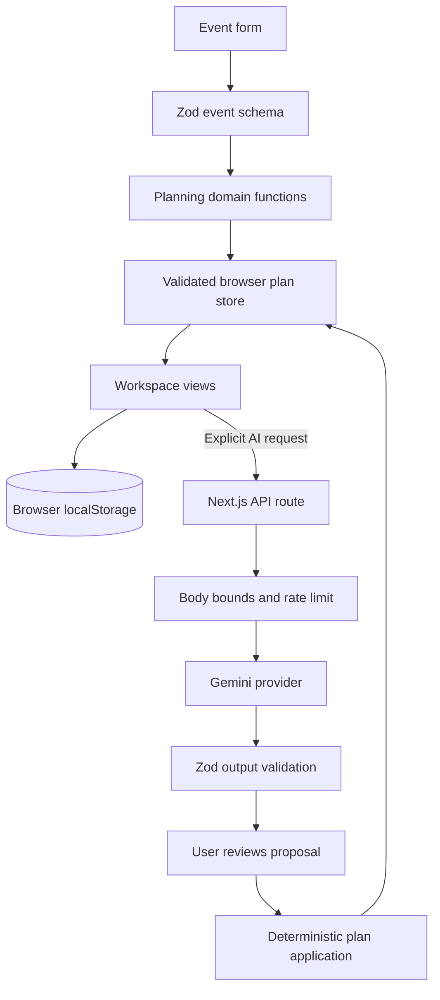

# Architecture

GatherWise is a modular Next.js application. The browser owns event data and deterministic planning
state; server routes provide bounded, opt-in Gemini suggestions. There is no account system or
remote event database in this version.

## Request and data flow

## Module responsibilities

| Area                                          | Responsibility                                                                              |
| --------------------------------------------- | ------------------------------------------------------------------------------------------- |
| `src/app/`                                    | Route entry points, global application composition, and workspace shell components.         |
| `src/app/styles/`                             | Ordered, feature-focused CSS layers imported by the global stylesheet entry point.          |
| `src/features/planning/schema.ts`             | Runtime schemas and inferred domain types shared by browser and server code.                |
| `src/features/planning/budget.ts`             | Integer budget allocation and priority weighting.                                           |
| `src/features/planning/plan-factory.ts`       | Initial plan, task, vendor, and run-of-show creation.                                       |
| `src/features/planning/plan-operations.ts`    | Validated task/expense/vendor/schedule edits and deterministic totals.                      |
| `src/features/planning/planner.ts`            | Stable domain export barrel for existing application callers.                               |
| `src/features/planning/hooks/`                | Browser persistence lifecycle, workspace actions, and cancellable AI requests.              |
| `src/server/ai/`                              | Gemini configuration, model fallback, time/output bounds, and provider response validation. |
| `src/server/http/` and `src/server/security/` | Streaming request bounds, safe HTTP responses, and rate-limit integration.                  |
| `src/proxy.ts`                                | Per-response CSP nonce and baseline response security headers.                              |
| `e2e/`                                        | Production-build browser journeys, security headers, and automated accessibility checks.    |

## Trust and state boundaries

- User input, browser storage, and model output are untrusted. Zod validates them when they cross
  application boundaries.
- Budget totals, dates, task status, and persisted plan edits are application-owned deterministic
  values. Gemini can suggest plan content but cannot commit changes by itself.
- AI calls happen only after a user action. API keys stay in server-only environment variables.
- Plan state stays in the current browser. Clearing browser storage removes the local plans; they do
  not sync across devices.
- Production AI requests require the configured shared rate limiter. The app bounds request bytes,
  model output, and provider wait time, and returns safe errors.

## Dependency direction

UI modules depend on planning schemas and domain operations. Domain functions do not depend on
React, Next.js, browser storage, or Gemini. Provider and persistence adapters depend inward on the
shared contracts; the domain does not depend on those adapters. This keeps budget and plan behavior
testable without a browser, database, or live AI key.
